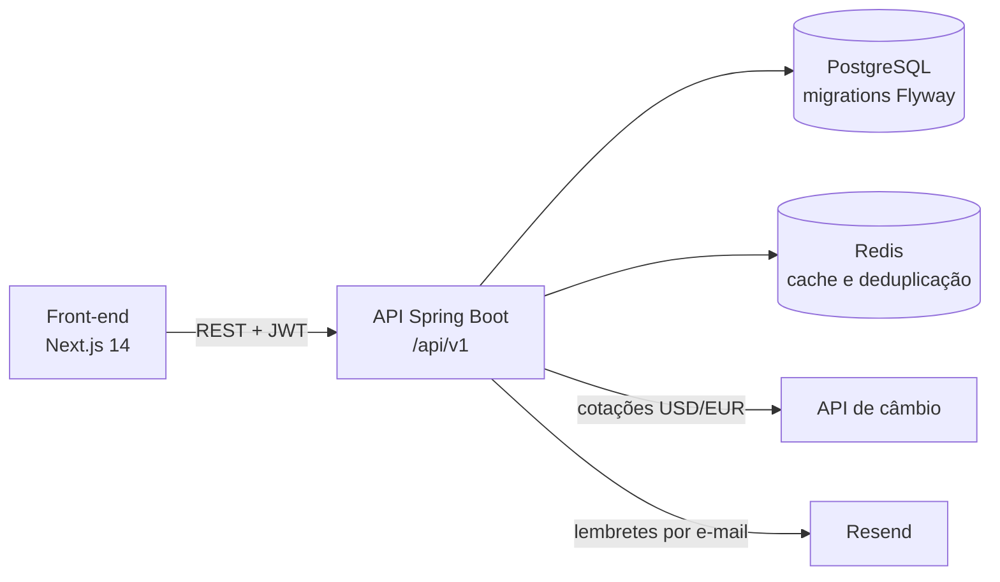
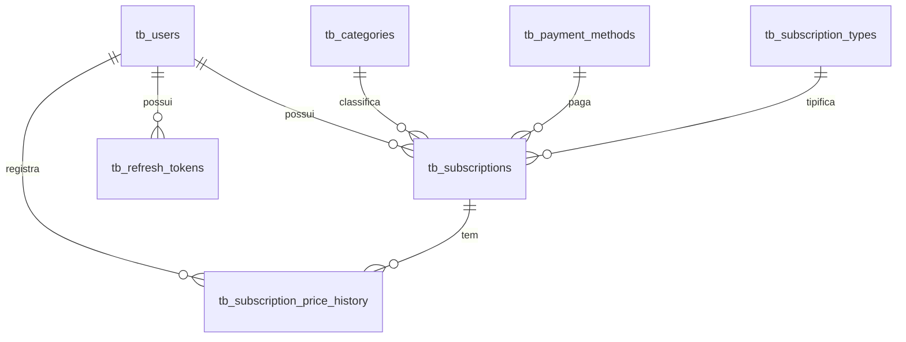

# Ongoing
 
Plataforma full-stack para acompanhar assinaturas recorrentes (streaming, SaaS, serviços): cadastro com ciclos de cobrança, dashboard de gastos convertido para BRL, histórico de reajustes de preço e lembretes de renovação por e-mail.
 
O foco do projeto é o back-end: uma **API REST em Java 25 e Spring Boot 4** com autenticação JWT, PostgreSQL versionado com Flyway, Redis e testes de integração com Testcontainers. O front-end em Next.js consome essa API.
 


 
## Funcionalidades
 
- **Assinaturas:** CRUD com filtros (nome, status, categoria) e paginação. Ciclos de cobrança `WEEKLY`, `BIWEEKLY`, `MONTHLY`, `QUARTERLY`, `SEMI_ANNUAL` e `YEARLY`, com cálculo da próxima data de cobrança. Valores em BRL, USD ou EUR.
- **Histórico de preços:** a cada alteração de valor, registra o valor anterior, o novo e a variação percentual. Reajustes de 10% ou mais são marcados como *price spike* e podem ser consultados por período.
- **Dashboard:** gasto por categoria, média mensal, total do mês e total anual, tudo em BRL. Valores em USD/EUR são convertidos por uma API de câmbio, com cotação em cache no Redis por 24 horas.
- **Lembretes por e-mail:** job diário às 08:00 que avisa, via Resend, as assinaturas ativas com notificação ligada que renovam no dia seguinte (um e-mail por usuário). Uma chave no Redis evita reenvio.
- **Contas de usuário:** cadastro, login e renovação de sessão. Cada usuário só enxerga os próprios dados.
## Arquitetura
 

 
Back-end em camadas (controller → service → repository), organizado por feature:
 
```
backend/src/main/java/dev/guilhermeluan/ongoing/
├── auth/            # register, login, refresh; JwtService e JwtAuthFilter
├── user/            # User, Role, RefreshToken e repositórios
├── subscriptions/   # CRUD, filtros e cálculo da próxima cobrança
│   ├── entities/        # Subscriptions, Category, PaymentMethod, SubscriptionType e enums
│   ├── pricehistory/    # histórico de reajustes e detecção de price spike
│   └── dto/
├── dashboard/       # agregações de gasto em BRL
├── exchange/        # cliente da API de câmbio (@HttpExchange) com cache
├── notification/    # job diário, envio via Resend e template HTML
├── status/          # health check com informações do banco
├── exception/       # GlobalExceptionHandler e exceções de domínio
└── config/          # Spring Security, CORS, Redis, rate limit, Resend
```
 
Modelo de dados (migrations `V1` a `V6` em `backend/src/main/resources/db/migration`):
 

 
## Decisões técnicas
 
| Tema | Como foi feito |
|---|---|
| Autenticação | Access token JWT (jjwt) com `userId`, `name` e `role` como claims, e refresh token opaco (UUID) salvo em `tb_refresh_tokens`. O refresh é rotacionado a cada uso (o anterior é apagado) e também é descartado se for apresentado já expirado. Senhas com BCrypt, sessão stateless. |
| Isolamento de dados | Todas as consultas de assinaturas filtram pelo `userId` extraído do token. Um recurso de outro usuário é tratado como inexistente (404). |
| Rate limiting | Bucket4j por IP: 5 requisições/min em `/api/v1/auth/**` e 60 requisições/min no restante. Excedeu, responde 429. |
| Cache | Cotações de câmbio com `@Cacheable` em Redis, TTL de 24 horas. |
| Lembretes sem duplicidade | Antes de enviar, o job consulta a chave `reminder:{userId}:{data}` no Redis e a grava com TTL de 48 horas após o envio. |
| Schema | Flyway versiona o schema; o Hibernate roda em `ddl-auto=validate` nos perfis `dev` e `production`. |
| Erros | `GlobalExceptionHandler` centraliza as respostas, com exceções de domínio (`BadRequestException`, `NotFoundException`, `InvalidCredentialException`). |
| Mapeamento | MapStruct entre entidades e DTOs; Bean Validation nos requests. |
| Concorrência | Virtual threads habilitadas (`spring.threads.virtual.enabled`). |
 
## Stack
 
| Camada | Tecnologias |
|---|---|
| Back-end | Java 25, Spring Boot 4.0, Spring Web MVC, Spring Security, Spring Data JPA, Spring Data Redis, MapStruct, Lombok, jjwt, Bucket4j, SDK do Resend |
| Banco e cache | PostgreSQL 16, Flyway, Redis 7 |
| Testes | JUnit, Mockito, Testcontainers (PostgreSQL e Redis), RestAssured |
| Infra | Docker Compose (ambiente local), GitHub Actions (CI), Railway e Neon (produção) |
| Front-end | Next.js 14 (App Router), TypeScript, Tailwind CSS, Axios, Vitest e Testing Library |
 
## API
 
Prefixo `/api/v1`. Exceto onde indicado, os endpoints exigem `Authorization: Bearer <access token>`.
 
| Método | Rota | Descrição |
|---|---|---|
| POST | `/auth/register` | Cria a conta e retorna os tokens (público) |
| POST | `/auth/login` | Autentica e retorna os tokens (público) |
| POST | `/auth/refresh` | Troca o refresh token por um novo par de tokens (público) |
| GET | `/status` | Estado da aplicação e informações do banco (público) |
| GET | `/subscriptions` | Lista paginada; filtros `name`, `active` e `categoryId` |
| GET | `/subscriptions/{id}` | Detalhe de uma assinatura |
| POST | `/subscriptions` | Cria assinatura (calcula a próxima cobrança) |
| PUT | `/subscriptions/{id}` | Atualiza; se o valor mudar, grava no histórico de preços |
| DELETE | `/subscriptions/{id}` | Remove (204) |
| GET | `/subscriptions/{id}/price-history` | Histórico de preços da assinatura |
| GET | `/subscriptions/price-spikes` | Reajustes de 10% ou mais; filtros `from` e `to` (padrão: últimos 30 dias) |
| GET | `/dashboard` | Totais e gasto por categoria em BRL |
 
## Como rodar
 
### Pré-requisitos
 
- Java 25
- Docker e Docker Compose
- Node.js 20 (apenas para o front-end)
O Maven não precisa estar instalado: o projeto usa o Maven Wrapper (`./mvnw`).
 
### 1. Subir PostgreSQL e Redis
 
```bash
docker compose up -d
```
 
### 2. Definir as variáveis de ambiente
 
O Spring Boot lê as variáveis do ambiente do processo:
 
```bash
export ACTIVE_PROFILE=dev
export JWT_SECRET=$(openssl rand -base64 32)   # chave em Base64
export JWT_EXPIRATION=900000                   # 15 min, em milissegundos
export JWT_REFRESH_EXPIRATION=604800000        # 7 dias, em milissegundos
export RESEND_API_KEY=re_sua_chave             # qualquer valor sobe a API; só é usado ao enviar e-mails
```
 
| Variável | Obrigatória | Padrão | Uso |
|---|---|---|---|
| `ACTIVE_PROFILE` | sim | — | `dev` ou `production` |
| `JWT_SECRET` | sim | — | Chave de assinatura do JWT (Base64) |
| `JWT_EXPIRATION` | sim | — | Validade do access token (ms) |
| `JWT_REFRESH_EXPIRATION` | sim | — | Validade do refresh token (ms) |
| `RESEND_API_KEY` | sim | — | Chave da API do Resend |
| `RESEND_FROM_EMAIL` | não | `onboarding@resend.dev` | Remetente dos lembretes |
| `EXCHANGE_API_URL` | não (dev) | exchangerate-api.com | API de cotações |
| `FRONTEND_URL` | não | `http://localhost:3000` | URL do front-end |
| `CORS_ALLOWED_ORIGINS` | não | `http://localhost:3000` | Origens permitidas, separadas por vírgula |
| `REDIS_HOST` / `REDIS_PORT` | não | `localhost` / `6379` | Conexão com o Redis |
 
No perfil `dev`, o banco aponta para o PostgreSQL do Docker Compose (`localhost:5432`). No perfil `production`, a API exige `POSTGRES_HOST`, `POSTGRES_PORT`, `POSTGRES_DB`, `POSTGRES_USER`, `POSTGRES_PASSWORD`, `REDIS_URL`, `REDIS_HOST`, `REDIS_PORT`, `REDIS_USERNAME`, `REDIS_PASSWORD` e `EXCHANGE_API_URL`, e a conexão com o PostgreSQL usa SSL.
 
### 3. Iniciar a API
 
```bash
cd backend
./mvnw spring-boot:run
```
 
A API fica em `http://localhost:6969/api/v1/`. As migrations rodam na inicialização.
 
### 4. Iniciar o front-end
 
```bash
cd frontend
npm install
npm run dev
```
 
O front-end abre em `http://localhost:3000` e usa `http://localhost:6969/api/v1` como API por padrão. Para outra URL, defina `NEXT_PUBLIC_API_URL` em `frontend/.env.local`.
 
## Testes
 
```bash
cd backend
 
./mvnw test      # testes unitários
./mvnw verify    # testes de integração (requer Docker)
 
# um teste específico
./mvnw test -Dtest=SubscriptionsServiceTest
./mvnw verify -Dit.test=SubscriptionsControllerIT
```
 
